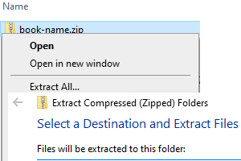

# Image Book Demonstration  

SumatraPDF must be recent 3.7 or NG with WebViewer2 installed in Windows 7/8/10/11 NOTE: SumatraPDF itself can be EITHER portable OR installed.  

Then if you only have the ExtractMe.zip first extract it (the name can be any you want like MyHolidayPhotos.zip  or Comic001 etc.)

You can then "drop" the OpenMe.html on SumatraPDF or use a shortcut or simply use SumatraPDF File Open (you may need to set filter to *.* All Types)  

When you have added all the image pages you want  you can use Manage > Export As.  

There are 2 options  
- A custom new Image book zip file
- Comic Book zip (.CBZ)
